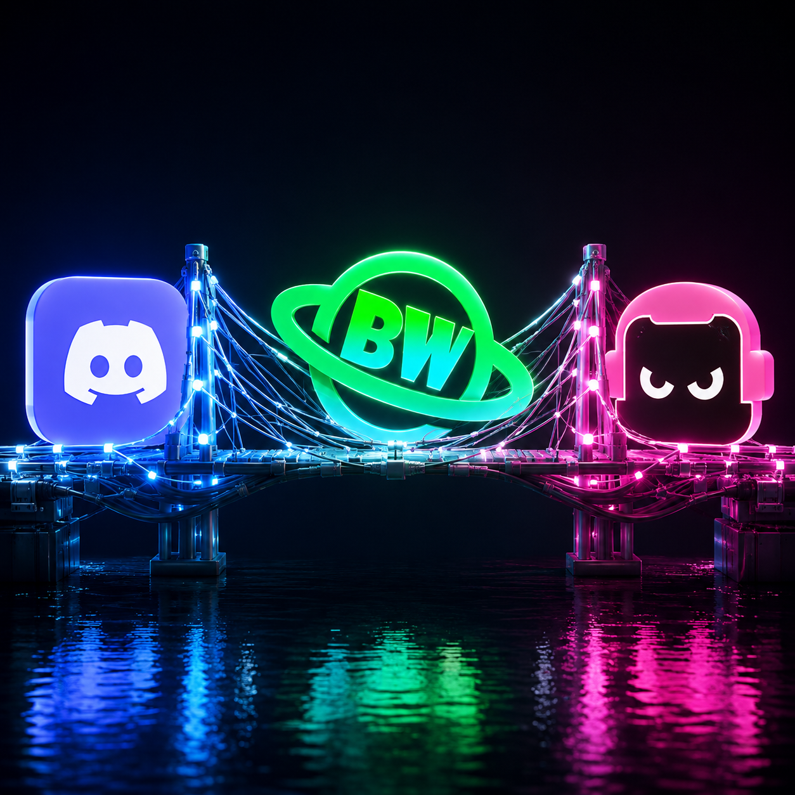

<div align="center">

# 🌉 Discord ↔ Lolka Voice Bridge

**Двусторонняя передача голоса между Discord и Lolka в реальном времени**



[](https://www.python.org/)
[](LICENSE)
[](https://github.com/bwproject/Discord-Lolka-Voice-Bridge/actions)

[Возможности](#-возможности) · [Установка](#-установка-и-запуск) · [Команды](#-команды) · [Диагностика](#-логи-и-диагностика) · [Лицензия](#-лицензия)

</div>

**Теги:** `discord` · `lolka` · `discordbot` · `lolkabot` · `bridge`

> **О проекте:** создан в формате вайбкодинга (vibe coding) с помощью **ChatGPT** и **OpenCode**.

> [!NOTE]
> Один экземпляр соединяет **один голосовой канал Discord** и **один голосовой канал Lolka**. Для нескольких пар каналов запустите несколько экземпляров с разными файлами `.env`.


## 📚 Содержание

- [Возможности](#-возможности)
- [Как это работает](#-как-это-работает)
- [Discord DAVE](#-discord-dave)
- [Требования](#-требования)
- [Установка и запуск](#-установка-и-запуск)
- [Команды](#-команды)
- [Права](#-права)
- [Логи и диагностика](#-логи-и-диагностика)
- [Устранение неполадок](#-устранение-неполадок)
- [Ограничения](#-ограничения-и-важные-замечания)
- [Структура проекта](#-структура-проекта)
- [CI и обновление](#-ci)
- [Лицензия](#-лицензия)

---

## ✨ Возможности

- Передаёт голос из Discord в Lolka и из Lolka в Discord.
- Смешивает несколько говорящих одновременно, отдельно для каждого направления.
- Автоматически подключается к каналам из `.env` после запуска.
- Не покидает голосовые каналы: команда `!bridge stop` не отключает ботов.
- Следит за состоянием подключений и переподключается при обрыве.
- Поддерживает Discord DAVE (E2EE) и применяет обходной путь для `discord.py` 2.7.x.
- Отправляет события входа и выхода участников в текстовые каналы обеих платформ.
- При запуске удаляет свои старые сообщения о входе/выходе из лог-каналов.
- Умеет выводить диагностический тон 440 Гц вместо реального аудио.
- Не записывает аудио на диск: обработка идёт в памяти.
- Показывает диагностические логи в stdout/stderr.

## 🔄 Как это работает

```text
Discord voice
    │  Opus + DAVE
    ▼
discord-ext-voice-recv
    │  PCM: signed 16-bit, 48 kHz, stereo, 20 ms
    ▼
DiscordPCMReceiveSink
    │
    ▼
PCMFrameMixer (discord_to_lolka)
    │
    ▼
LolkaMixerAudioSource
    │  WebRTC AudioFrame
    ▼
Lolka voice


Lolka voice
    │  WebRTC AudioFrame
    ▼
PyAV AudioResampler
    │  PCM: signed 16-bit, 48 kHz, stereo, 20 ms
    ▼
PCMFrameMixer (lolka_to_discord)
    │
    ▼
MixerAudioSource
    │  Opus + DAVE
    ▼
Discord voice
```

Основные детали:

- Входящее аудио Discord декодируется в PCM через `discord-ext-voice-recv`.
- Входящее аудио Lolka приводится к тому же формату через PyAV.
- Для каждого говорящего создаётся отдельная очередь кадров.
- Кадры смешиваются в 20-миллисекундные PCM-фреймы.
- При переполнении очереди отбрасываются старые кадры, чтобы не росла задержка.
- Собственный Discord-аккаунт моста игнорируется при приёме, чтобы не создавать петлю.
- Собственный Lolka-аккаунт моста также игнорируется.
- Аудио от других ботов не отбрасывается: мост может работать в связке ботов.

## 🔐 Discord DAVE

Discord использует обязательное сквозное шифрование DAVE в голосовых каналах. Для работы моста нужны:

- `discord.py[voice]` версии 2.7.1 или новее;
- `davey` для работы с MLS/DAVE;
- DAVE-совместимая сборка `discord-ext-voice-recv`, закреплённая в `requirements.txt`.

В `discord.py` 2.7.x переходы DAVE учитываются для согласования версии протокола, но методы `DaveSession.prepare_transition()` и `DaveSession.execute_transition()` не вызываются. Из-за этого сессия `davey` навсегда остаётся в состоянии `ready=False`, а `can_encrypt` остаётся `False`:

- входящие кадры Discord не расшифровываются и отбрасываются;
- исходящее аудио в Discord отправляется без E2EE, поэтому участники его не слышат.

В `bridge/dave.py` реализован временный обходной путь:

- `VoiceConnectionState._execute_transition` дополняется вызовом `execute_transition()`;
- после обработки MLS commit/welcome вызывается `prepare_transition()`;
- переходы подготавливаются сразу после commit/welcome, не дожидаясь отдельного события;
- если в установленной версии `discord.py` уже есть вызовы `prepare_transition`, патч автоматически отключается.

Патч использует внутренний API `discord.py`, поэтому версии зависимостей закреплены намеренно. Не обновляйте `discord.py`, `davey` и `discord-ext-voice-recv` без проверки входящего и исходящего звука.

Полезные строки логов:

```text
bridge.dave | Включён DAVE-патч для применения transition в davey
bridge.manager | Discord DAVE: protocol=1 can_encrypt=False session_ready=False
bridge.dave | DAVE transition 0 подготовлен: protocol=1 ready=True can_encrypt=True
bridge.dave | DAVE transition 0 применён: protocol=1 ready=True can_encrypt=True
```

Пока бот один в голосовом канале, `session_ready` может оставаться `False`: для первой DAVE-транзишена обычно нужен второй участник. После входа пользователя появляются MLS proposals/commit, и сессия становится ready. После входа подождите несколько секунд и проверьте логи.

Если в логах есть такие строки, значит входящее аудио ещё не может быть расшифровано:

```text
DAVE: dropped N undecryptable frame(s) on ssrc ... (session not ready)
```

## 📋 Требования

- Python 3.11 или новее.
- Два bot-аккаунта: Discord и Lolka.
- Оба бота добавлены на нужные серверы.
- Доступ к голосовым каналам и, при необходимости, к текстовым каналам для логов.
- Для `discord.py[voice]` может потребоваться системная библиотека Opus (`libopus0` в Debian/Ubuntu, `opus` в некоторых других дистрибутивах).
- Стабильное интернет-соединение и доступ к Discord и Lolka.

Зависимости Python перечислены в `requirements.txt`:

- `discord.py[voice]`;
- DAVE-совместимая сборка `discord-ext-voice-recv`;
- `davey`;
- `lolka.py`;
- `numpy`;
- `python-dotenv`.

## 🚀 Установка и запуск

> [!IMPORTANT]
> Для работы нужны **два отдельных бота** — Discord и Lolka. Оба должны быть добавлены на серверы и иметь доступ к голосовым каналам.

Для работы моста нужны **два бота**: один в Discord и один в Lolka. Оба бота должны быть добавлены на нужные серверы и иметь доступ к соответствующим голосовым каналам, включая разрешения на подключение и передачу звука.

> **P.S.** Discord может быть недоступен из России. Поэтому запускайте мост на сервере или компьютере, откуда есть доступ к Discord (например, с настроенным «обходом» или за пределами РФ). Важно, чтобы именно устройство, на котором выполняется `python main.py`, могло подключаться к Discord API и голосовым серверам.

### 1. Создайте ботов

- Discord: [Discord Developer Portal](https://discord.com/developers/applications) — создайте приложение, добавьте Bot и получите токен.
- Lolka: [Документация по созданию ботов Lolka](https://lolka.app/developers/bots) — создайте бота и получите токен.

Добавьте каждого бота на нужный сервер и выдайте ему доступ к голосовому каналу.

### 2. Скопируйте репозиторий

```bash
git clone https://github.com/bwproject/Discord-Lolka-Bridge.git
cd Discord-Lolka-Bridge
```

### 3. Установите зависимости Python

```bash
python -m pip install -r requirements.txt
```

### 4. Укажите токены и ID голосовых каналов

Создайте файл `.env` на основе шаблона:

```bash
cp .env.example .env
```

Откройте `.env` и укажите:

- `DISCORD_BOT_TOKEN` — токен Discord-бота;
- `DISCORD_VOICE_CHANNEL_ID` — ID голосового канала Discord;
- `LOLKA_BOT_TOKEN` — токен Lolka-бота;
- `LOLKA_VOICE_CHANNEL_ID` — ID голосового канала Lolka.

Пример:

```dotenv
DISCORD_BOT_TOKEN=токен_discord_бота
DISCORD_VOICE_CHANNEL_ID=ID_голосового_канала_discord

LOLKA_BOT_TOKEN=токен_lolka_бота
LOLKA_VOICE_CHANNEL_ID=ID_голосового_канала_lolka
```

Остальные параметры в `.env.example` необязательны. Не публикуйте файл `.env` и не добавляйте его в git — в репозитории должен находиться только `.env.example`.

### 5. Запустите бота

```bash
python main.py
```

После запуска оба бота подключатся к указанным голосовым каналам и начнут передавать звук в обе стороны.

## 🎛️ Команды

Команды работают в текстовых каналах Discord и Lolka с префиксом `COMMAND_PREFIX`.

| Команда | Действие |
|---|---|
| `!bridge start` | Немедленно проверить и восстановить оба голосовых подключения |
| `!bridge connect` | То же, что `!bridge start` |
| `!bridge status` | Показать, подключены ли оба бота |
| `!bridge stop` | Ничего не отключает: боты остаются в голосовых каналах |

В Discord для команд нужно право `Manage Server`. В Lolka команда проверяет `manage_guild`, если библиотека предоставляет объект прав участника.

## 🔑 Права

### Discord

Минимально необходимы:

- `View Channels`;
- `Connect`;
- `Speak`;
- `Use Voice Activity`;
- `Send Messages`;
- `Read Message History`.

Дополнительно:

- включите `Message Content Intent` в Discord Developer Portal, иначе prefix-команды не будут работать;
- для отправки событий входа/выхода бот должен видеть текстовый лог-канал;
- для очистки своих старых сообщений нужен доступ к истории канала;
- для приёма голоса нужен доступ к голосовому каналу и разрешение `Connect`.

### Lolka

Боту нужны доступ к голосовому каналу, разрешение говорить и доступ к текстовому каналу, если включены логи или команды. Для управления мостом требуется право управления сервером, если оно есть в модели прав Lolka.

## 🩺 Логи и диагностика

Логи выводятся в stdout/stderr и видны в консоли, из которой запущен `python main.py`.

Формат:

```text
2026-11-04 19:00:00 | INFO | voice-bridge | Discord bot готов: ...
2026-11-04 19:00:01 | INFO | bridge.manager | Discord: бот подключён к ...
2026-11-04 19:00:02 | INFO | bridge.manager | Lolka: бот подключён к ...
```

Что логируется:

- запуск и готовность клиентов;
- подключение и отключение голосовых каналов;
- переподключения и ошибки;
- входящие аудиопотоки и статистика передачи раз в 5 секунд;
- состояние DAVE: протокол, `can_encrypt`, `session_ready`;
- подготовка и применение DAVE-переходов;
- события входа/выхода участников;
- отправка и очистка лог-сообщений.

Для диагностики `discord.gateway` намеренно переведён в `DEBUG`, чтобы были видны детали голосового WebSocket. Логи `discord.ext.voice_recv.reader` для обычных RTCP Sender Report приглушены до `WARNING`.

Содержимое аудио в логи не выводится. Токены ботов не логируются. При включённом `DEBUG` для `discord.gateway` в логах могут быть видны служебные voice-токены, `session_id` и другие параметры голосового соединения — не публикуйте такие логи.

### Диагностический тон

`DIAGNOSTIC_TONE=true` заменяет реальное аудио в обоих направлениях на тон 440 Гц. Это нужно, чтобы проверить тракт воспроизведения независимо от микрофонов и кодаков:

1. Установите `DIAGNOSTIC_TONE=true` в `.env`.
2. Перезапустите процесс.
3. Зайдите в оба голосовых канала.
4. В логах появятся строки `включён диагностический тон 440 Гц`.
5. Если тон слышен в Lolka, но не слышен в Discord, проблема в Discord playback/DAVE.
6. Если тон слышен в Discord, но не слышен в Lolka, проблема в Lolka playback.
7. После проверки верните `DIAGNOSTIC_TONE=false` и перезапустите бота.

При включённом тоне голос участников не передаётся.

### Очистка лог-каналов

При старте бот просматривает историю указанных лог-каналов и удаляет только свои сообщения, содержащие текст о входе или выходе из голосового канала. Сообщения пользователей и другие сообщения не затрагиваются. Если прав на историю или удаление нет, ошибка логируется, но запуск моста продолжается.

## 🧰 Устранение неполадок

### В Discord тишина

Проверьте в логах:

```text
Discord DAVE: protocol=1 can_encrypt=True session_ready=True
```

Если `can_encrypt=False` или `session_ready=False`:

- убедитесь, что загрузился `bridge.dave` и в логах есть `Включён DAVE-патч`;
- проверьте, что в канале есть второй участник: для первой DAVE-транзишена обычно нужен пользователь;
- подождите несколько секунд после входа пользователя;
- проверьте строки `DAVE transition ... подготовлен/применён`;
- не обновляйте вручную `discord.py`, `davey` и `discord-ext-voice-recv`;
- проверьте, что установлены зависимости из `requirements.txt`.

Если в логах есть `DAVE: dropped ... (session not ready)`, входящее аудио Discord ещё не расшифровывается.

Также проверьте права `Connect`, `Speak`, `Use Voice Activity` и то, что бот действительно находится в нужном канале.

### В Lolka тишина

- Проверьте, что бот подключён к голосовому каналу Lolka.
- Проверьте, что в логах есть `Lolka: получен первый PCM-кадр`.
- Проверьте `Lolka -> Discord` и `Discord -> Lolka` в логах.
- Убедитесь, что у бота есть разрешение говорить в Lolka.
- Проверьте совместимость установленной версии `lolka.py` с voice receive.

### Бот не подключается

- Проверьте токены и ID каналов в `.env`.
- Если задан `DISCORD_GUILD_ID` или `LOLKA_GUILD_ID`, проверьте, что бот состоит на этом сервере.
- Проверьте, что канал существует и является голосовым.
- Проверьте доступ к Discord/Lolka и отсутствие блокировок сети.
- Посмотрите traceback в логах: супервизор повторяет попытку, но не скрывает причину ошибки.

### Команды не работают

- Проверьте `COMMAND_PREFIX`.
- В Discord включите `Message Content Intent`.
- В Discord у пользователя должно быть право `Manage Server`.
- В Lolka проверьте право управления сервером, если библиотека его предоставляет.

### Не приходят события входа/выхода

- Проверьте `DISCORD_LOG_CHANNEL_ID` и `LOLKA_LOG_CHANNEL_ID`.
- Проверьте права: просмотр канала, чтение истории, отправка сообщений.
- Если ID не задан, события для этой платформы просто не отправляются.

### Тон не слышен

- Проверьте, что в `.env` стоит `DIAGNOSTIC_TONE=true`, и процесс перезапущен.
- В логах должно быть `включён диагностический тон 440 Гц`.
- Если тон не слышен только в Discord, смотрите раздел про DAVE.
- Если тон не слышен только в Lolka, проверьте Lolka playback и права.

## ⚠️ Ограничения и важные замечания

- Один экземпляр обслуживает один канал Discord и один канал Lolka. Для нескольких пар каналов нужно несколько экземпляров.
- Мост не записывает аудио на диск, но участники должны быть уведомлены о работе голосового моста и о возможной передаче голоса между платформами.
- DAVE-патч опирается на внутренний API `discord.py`. Версии зависимостей закреплены намеренно.
- `discord-ext-voice-recv` находится в alpha и может менять API.
- Совместимость `lolka.py` с voice receive нужно проверять на тестовом канале.
- Боты должны постоянно находиться в голосовых каналах. Если процесс упал, автопереподключение не поможет, пока процесс не будет запущен снова.
- Аудио от других ботов не игнорируется; игнорируется только собственный аккаунт моста, чтобы не создавать петлю.
- Для первой DAVE-транзишена обычно нужен второй участник в канале. Если бот один, `session_ready` может быть `False`.
- После входа пользователя DAVE-сессия может инициализироваться несколько секунд. Это нормально.

## 📁 Структура проекта

```text
.
├── main.py                 # запуск, клиенты, события, команды, супервизор
├── bridge/
│   ├── __init__.py
│   ├── audio.py            # PCM-микшер, AudioSource, диагностический тон
│   ├── config.py           # чтение и проверка .env
│   ├── dave.py             # обходной путь для DAVE-переходов
│   └── manager.py          # подключения, приём и передача аудио, логи
├── requirements.txt        # закреплённые зависимости
├── .env.example            # шаблон без секретов
└── README.md
```

## ⚙️ CI

GitHub Actions запускается на push в `main`/`feature/**` и на pull request:

- устанавливает зависимости из `requirements.txt`;
- проверяет импорт `discord`, `davey`, `lolka` и `discord.ext.voice_recv`;
- запускает `python -m compileall -q main.py bridge`.

CI не проверяет реальный звук: для этого нужны живые голосовые каналы Discord и Lolka.

## 🔄 Обновление

```bash
git pull --ff-only
python -m pip install -r requirements.txt
```

Затем перезапустите процесс или контейнер. Не обновляйте голосовые зависимости вручную без проверки DAVE и двустороннего звука.

---

<div align="center">

**ProjectBW · Discord ↔ Lolka Voice Bridge**

</div>

## 📄 Лицензия

Проект распространяется под лицензией [MIT](LICENSE). Полный текст лицензии находится в файле [LICENSE](LICENSE).
